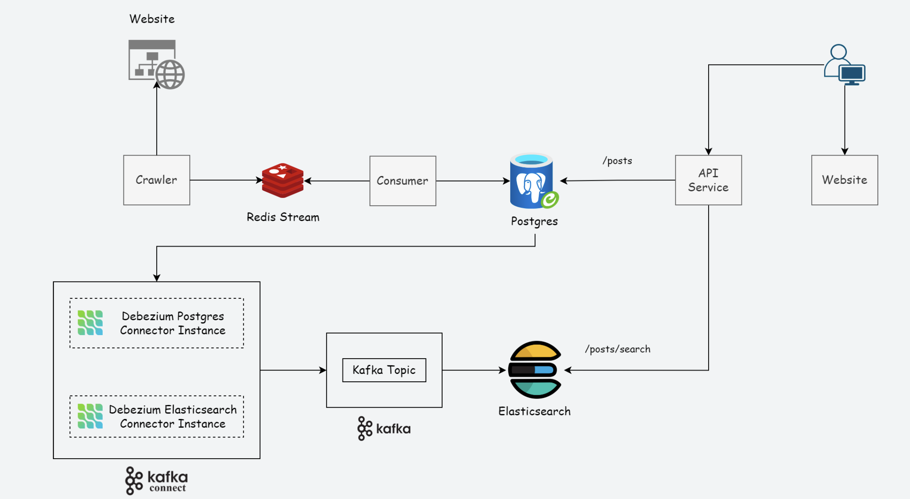

# Crawler system

🕷️ Crawler System Architecture

This architecture describes a full pipeline that crawls data from websites, processes it through Redis and PostgreSQL, and synchronizes it into Elasticsearch via Kafka Connect for high-performance search capabilities.

🔄 System Flow Breakdown
1. Website & Crawler
A crawler scrapes or fetches data from target websites.

This data is pushed into a Redis Stream, enabling asynchronous processing.

2. Redis Stream & Consumer
The Redis Stream acts as a lightweight message queue.

A consumer listens to this stream, processes the messages, and writes the relevant content to a PostgreSQL database.

3. PostgreSQL
Acts as the primary data store.

New posts are accessible via the /posts endpoint through the API Service.

It is also monitored by Debezium (CDC - Change Data Capture) for changes.

4. Kafka Connect with Debezium
Debezium Postgres Connector captures changes from PostgreSQL and pushes them into a Kafka Topic.

Debezium Elasticsearch Connector reads from that Kafka Topic and writes updates into Elasticsearch.

5. Elasticsearch
Stores documents optimized for search and supports advanced querying.

The API provides a /posts/search endpoint backed by Elasticsearch.

6. API Service
Serves the frontend with both /posts (from Postgres) and /posts/search (from Elasticsearch).

Enables the user interface (Website) to consume and display this data efficiently.

🔧 Technologies Used
Component	Technology
Message Queue	Redis Stream
Database	PostgreSQL
Change Data Capture	Debezium (Postgres → Kafka)
Stream Processing	Kafka
Search Engine	Elasticsearch
Backend API	Node.js / FastAPI / etc.
Crawler	Python Scrapy / Puppeteer

### `npm start`

Runs the app in the development mode.\
Open [http://localhost:3000](http://localhost:3000) to view it in your browser.

The page will reload when you make changes.\
You may also see any lint errors in the console.

### `npm test`

Launches the test runner in the interactive watch mode.\
See the section about [running tests](https://facebook.github.io/create-react-app/docs/running-tests) for more information.

### `npm run build`

Builds the app for production to the `build` folder.\
It correctly bundles React in production mode and optimizes the build for the best performance.

The build is minified and the filenames include the hashes.\
Your app is ready to be deployed!

See the section about [deployment](https://facebook.github.io/create-react-app/docs/deployment) for more information.

### `npm run eject`

**Note: this is a one-way operation. Once you `eject`, you can't go back!**

If you aren't satisfied with the build tool and configuration choices, you can `eject` at any time. This command will remove the single build dependency from your project.

Instead, it will copy all the configuration files and the transitive dependencies (webpack, Babel, ESLint, etc) right into your project so you have full control over them. All of the commands except `eject` will still work, but they will point to the copied scripts so you can tweak them. At this point you're on your own.

You don't have to ever use `eject`. The curated feature set is suitable for small and middle deployments, and you shouldn't feel obligated to use this feature. However we understand that this tool wouldn't be useful if you couldn't customize it when you are ready for it.

## Learn More

You can learn more in the [Create React App documentation](https://facebook.github.io/create-react-app/docs/getting-started).

To learn React, check out the [React documentation](https://reactjs.org/).

### Code Splitting

This section has moved here: [https://facebook.github.io/create-react-app/docs/code-splitting](https://facebook.github.io/create-react-app/docs/code-splitting)

### Analyzing the Bundle Size

This section has moved here: [https://facebook.github.io/create-react-app/docs/analyzing-the-bundle-size](https://facebook.github.io/create-react-app/docs/analyzing-the-bundle-size)

### Making a Progressive Web App

This section has moved here: [https://facebook.github.io/create-react-app/docs/making-a-progressive-web-app](https://facebook.github.io/create-react-app/docs/making-a-progressive-web-app)

### Advanced Configuration

This section has moved here: [https://facebook.github.io/create-react-app/docs/advanced-configuration](https://facebook.github.io/create-react-app/docs/advanced-configuration)

### Deployment

This section has moved here: [https://facebook.github.io/create-react-app/docs/deployment](https://facebook.github.io/create-react-app/docs/deployment)

### `npm run build` fails to minify

This section has moved here: [https://facebook.github.io/create-react-app/docs/troubleshooting#npm-run-build-fails-to-minify](https://facebook.github.io/create-react-app/docs/troubleshooting#npm-run-build-fails-to-minify)
